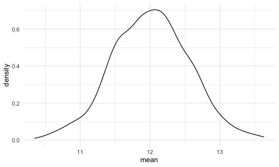
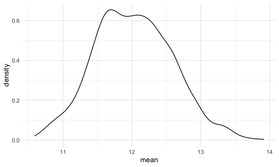
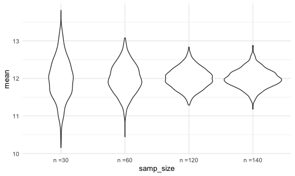
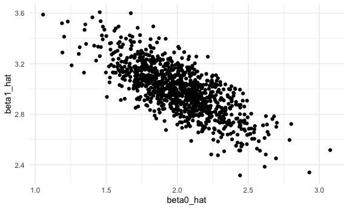
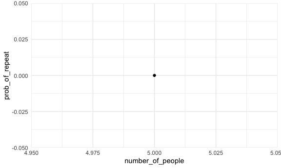

Simulation
================

``` r
library(tidyverse)

source("source/sim_mean_sd.R")
source("source/sim_slr.R")
source("source/birthday_repeated.R")

set.seed(1236)
```

## Mean and SD

Can we check CLT using simulation

``` r
sim_mean_sd(n_obs = 30)
```

    ## # A tibble: 1 × 2
    ##    mean    sd
    ##   <dbl> <dbl>
    ## 1  12.5  2.60

Keep track of results

``` r
output = vector("list", length = 1000)

for (i in 1:1000) {
  output[[i]] = sim_mean_sd(n_obs = 30)
}
```

Inspect results

``` r
output |> 
  bind_rows() |> # stack up rows
  summarize(
    emp_m = mean(mean),
    emp_se = sd(mean)
  )
```

    ## # A tibble: 1 × 2
    ##   emp_m emp_se
    ##   <dbl>  <dbl>
    ## 1  12.0  0.551

``` r
output |> 
  bind_rows() |> 
  ggplot(aes(x = mean)) +
  geom_density()
```



Using tibbles and map instead

``` r
sim_results_df = 
  tibble(
    samp_size = rep(30, 1000)
  ) |> 
  mutate(
    est_df = map(samp_size, sim_mean_sd)
  ) |> 
  unnest(est_df)
```

Look at results

``` r
sim_results_df |> 
  ggplot(aes(x = mean)) + 
  geom_density()
```



## change `n`

``` r
sim_results_df = 
  expand_grid(
    samp_size = c(30,60,120,140),
    iter = 1:1000
  ) |> 
  mutate(
    est_df = map(samp_size, sim_mean_sd)
  ) |> 
  unnest(est_df)
```

``` r
sim_results_df |> 
  mutate(
    samp_size = str_c("n =", samp_size),
    samp_size = fct_inorder(samp_size)
    )|> 
  ggplot(aes(x = samp_size, y = mean)) + 
  geom_violin()
```



## SLR!!!

generate once

``` r
sim_data = 
  tibble(
    x = rnorm(30, mean = 1, sd = 1),
    y = 2 + 3 * x + rnorm(30, mean = 0, sd = 1)
  )

#sim_data |> 
#  ggplot(aes(x = x, y = y)) +
#  geom_point() +
#  geom_smooth(method = "lm", se = FALSE)

sim_data |> 
  lm(y~x, data = _)
```

    ## 
    ## Call:
    ## lm(formula = y ~ x, data = sim_data)
    ## 
    ## Coefficients:
    ## (Intercept)            x  
    ##       1.835        3.104

``` r
# or
fit = lm(y~x, data = sim_data)
```

turn it into a function (it’s in `source/sim_slr.R`)

``` r
sim_slr(30)
```

    ## # A tibble: 1 × 2
    ##   beta0_hat beta1_hat
    ##       <dbl>     <dbl>
    ## 1      1.86      3.37

Do this a lot

``` r
slr_result_df = 
  tibble(
    samp_size = rep(30, 1000)
  ) |> 
  mutate(
    est_df = map(samp_size, sim_slr)
  ) |> 
  unnest(est_df)
```

is this right?

``` r
slr_result_df |> 
  summarize(
    b0_mean = mean(beta0_hat),
    b0_sd = sd(beta0_hat)
  )
```

    ## # A tibble: 1 × 2
    ##   b0_mean b0_sd
    ##     <dbl> <dbl>
    ## 1    2.00 0.267

Look at the results

``` r
slr_result_df |> 
  ggplot(aes(x = beta0_hat, y = beta1_hat)) +
  geom_point()
```



``` r
# It shows that they are slope and intercept are negatively correlated (not really surprsied thing)
```

## Birthday problem

``` r
# 5 ppl in the room and prob they have the same birthday
birthdays = sample(1:365, size = 5, replace = TRUE)

repeated_birthdays = length(unique(birthdays)) <5
repeated_birthdays
```

    ## [1] FALSE

turn this in to a function

``` r
birthday_repeated(147)
```

    ## [1] TRUE

run it a bunch but good

``` r
birthday_results_df = 
  tibble(
    number_of_people = rep(5,10)
  ) |> 
  mutate(
    repeated = map_lgl(number_of_people, birthday_repeated)
  )

#birthday_results_df = 
#  expand_grid(
#    number_of_people = 5:50,
#    iter = 1:1000
#  ) |> 
#  mutate(
#    repeated = map_lgl(number_of_people, birthday_repeated)
#  )
```

look at the results

``` r
birthday_results_df |> 
  group_by(number_of_people) |> 
  summarize(prob_of_repeat = mean(repeated)) |> 
  ggplot(aes(x = number_of_people, y = prob_of_repeat)) +
  geom_point() +
  geom_line()
```

    ## `geom_line()`: Each group consists of only one observation.
    ## ℹ Do you need to adjust the group aesthetic?


